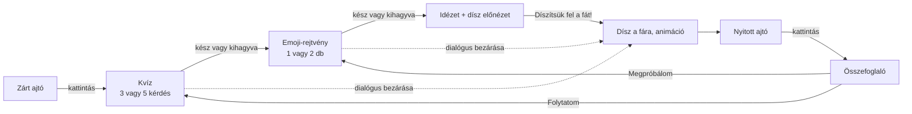

# A specifikáció átnézése – észrevételek és javasolt döntések

2026. november 11. · A [specifikáció](SPEC.md) átnézésének eredménye.

> **Állapot: lezárva (2026. november 11.).** Minden pontról döntés született, és a döntések bekerültek a [specifikációba](SPEC.md). Ez a dokumentum innentől a döntések indoklását őrzi; ha eltér a specifikációtól, a specifikáció az érvényes. Az alábbi pontok „a spec” megfogalmazásai az átnézés előtti szöveget írják le.

## A meghozott döntések

| Pont | Döntés |
| --- | --- |
| A1 | A dísz az ajtó nyitásakor jár; a mentés azt tárolja, lefutott-e a fa-animáció (`ornamentShown`). |
| A2 | A `VITE_UNLOCK_ALL` a Netlify-előnézeten is működik (`netlify.toml`); a `?date=` csak fejlesztői módban. |
| A3 | A zárolt ajtó relatív időt ír: „Holnap nyílik” / „5 nap múlva nyílik”. |
| A4 | A december 1-jei felirat fix szöveg a szótárban, paraméter csak a napok száma. |
| A5 | Díszhelyek: `x` 0–100, `y` 0–120, közvetlenül a rajz egységeiben. |
| A6 | Kevesebb alakzat, több szín: 12 rajz adja ki a 24 díszt (az új lista a specben van). |
| A7 | A fényfüzér kikerült, a 21. nap ezüst gömb; a fények a 24. nap jutalmai. |
| B1 | A keverés seedje a kérdés azonosítója; a mentés eredeti indexet tárol. |
| B2 | Több fül szinkronja `HYDRATE` akcióval, írás csak tényleges változáskor. |
| B3 | A fa színei SVG-attribútumként, `palette` propon át; a kártya szövegét a Canvas rajzolja. |
| B4 | A megosztandó kép a dialógus megnyitásakor készül el. |
| B5 | Éjfélkor az oldal magától frissül (`useNow()`). |
| B6 | Helyi idejű dátumok, `new Date(YEAR, 11, n)`. |
| B7 | Nem döntés, hanem teendő: az első dialógustesztnél ellenőrizni kell a jsdom `<dialog>` támogatását. |
| C1 | A `?lang=` paraméter nem menti el a nyelvet. |
| C2 | A dialógus a háttérre kattintva is bezárul. |
| C3 | A zárolt ajtó fókuszálható, `aria-disabled`. |
| C4 | A visszajelzések `aria-live` régióban vannak. |
| C5 | A rejtvény mentésében csak a `status` marad, a `solved` kikerült. |
| C6 | December 24. után minden nyitható marad (változatlan). |
| C7 | Elgépelés-tűrés az első kiadásban nincs. |
| C8 | Az idézet szerzője kétnyelvű mező. |
| C9 | A dísz külön `shape` és `color` mezőt kap. |
| C10 | Baloo 2 saját kiszolgálással (`@fontsource/baloo-2`). |
| E1 | A protótípus bekerült: `docs/prototype.html`. |
| E4 | A Vite váz a meglévő mappába kerül (`yarn create vite .`). |
| Fájlnév | A specifikáció neve `docs/SPEC.md`. |
| Ütemterv | A vágási lista elfogadva; az első Netlify-kiadás az első napon történik. |

## Az eredeti észrevételek

A specifikáció összességében jó és megvalósítható: a számai stimmelnek (74 kérdés, 25 rejtvény, 50 tipp, „még 20 nap”), a hatókör világos. Az alábbi pontok azok a helyek voltak, ahol a szöveg ellentmondott önmagának, hiányzott belőle egy döntés, vagy a leírt megoldás a gyakorlatban nem működött volna.

A többi dokumentum (`02`–`04`, `CLAUDE.md`) ezekre az azonosítókra hivatkozik.

## Előfeltételek, amik hiányoznak a repóból

| # | Hiány | Miért számít |
| --- | --- | --- |
| E1 | **A HTML/CSS protótípus nincs a repóban.** A spec szerint ez a dizájn forrása (`docs/prototype.html`). | Enélkül az 1. fázis (ajtók, rács, animációk „változatlan” átültetése) nem kezdhető el; a spec csak a tokeneket írja le, a csomagolópapír-mintákat, ajtóméreteket, a rács sorrendjét nem. |
| E2 | Nincs git repó, nincs `CLAUDE.md`. | A `CLAUDE.md`-t elkészítettem a gyökérben; a `git init` az 1. fázis első lépése. |
| E3 | A „napi folyamat” ábra az exportnál elveszett (`[embedded content…]`). | Lent pótoltam. |
| E4 | A projektmappa `advent-app`, a spec parancsa `adventi-kalendarium` nevű almappát hozna létre. | A meglévő mappában: `yarn create vite . --template react-ts` (a nem üres mappára rákérdez; a `docs/` maradhat). |

### A napi folyamat (pótolt ábra)



## Ellentmondások a specifikáción belül

**A1 – Mikor jár a dísz?** Három helyen három megfogalmazás van: „a nap megnyitása után mindenképp”, „amikor az idézethez ér”, „bezáráskor is”. Kimaradt eset: a játékos a *fület* zárja be a dialógus közben, ekkor a nap megnyitott, de `ornamentEarned: false` marad.
*Javaslat:* a dísz az `OPEN_DAY` pillanatában jár, az `ornamentEarned` mező elhagyható (megszerzett = a nap szerepel a `days`-ben). Ami külön tárolandó, az az, hogy a **fa-animáció lement-e már** (`ornamentShown: boolean`), hogy a félbeszakított nap dísze a következő betöltéskor essen a helyére.

**A2 – `VITE_UNLOCK_ALL` „kiesik az éles buildből”, de a Deploy Preview-n használni kell.** A Netlify előnézet is éles (`PROD`) build, tehát a kapcsolónak ott működnie kell.
*Javaslat:* a `VITE_UNLOCK_ALL` bármilyen buildben él, ha be van állítva; csak a `?date=` paraméter van `import.meta.env.DEV`-hez kötve. A beállítás kerüljön a `netlify.toml`-ba, ne a felületre:

```toml
[context.deploy-preview.environment]
  VITE_UNLOCK_ALL = "true"
```

**A3 – A zárolt ajtó üzenete.** A komponensleírás szerint „hány nap múlva nyílik”, a dátumzár-szakasz szerint „mikor nyílik”. A dátumos változat magyarul 24-féle toldalékot kíván (1-jén, 2-án, 4-én…).
*Javaslat:* a relatív forma: „Holnap nyílik” / „5 nap múlva nyílik” (`Intl.PluralRules` az angolhoz). Nem kell toldaléktábla.

**A4 – `banner.opens: 'Az első ablak {date}-jén nyílik'`.** Az `Intl.DateTimeFormat('hu')` „december 1.”-et ad, ebből „december 1.-jén” lenne. A dátum ráadásul állandó.
*Javaslat:* a szótárban fix szöveg („Az első ablak december 1-jén nyílik” / “The first door opens on December 1”), paraméter csak a hátralévő napok száma.

**A5 – A díszhelyek koordinátái.** A `slot` „0–100”, a `viewBox` viszont `0 0 100 120`. A 23. nap („Ajándékok a fa alatt”) biztosan `y > 100`.
*Javaslat:* `x: 0–100`, `y: 0–120`, a tartalomteszt ezt ellenőrizze.

**A6 – „Kb. 12 rajz elég a 24 díszhez.”** A javasolt listában az 5 gömb egy alakzat, a maradék 19 dísz mind különböző: ez **20 alakzat**, nem 12. A 2–3 napos fa-becslés ezzel alul van tervezve.
*Javaslat:* vagy a lista egyszerűsödik (több színváltozat: gömb, csengő, masni, csillag, cukorpálca 2–3 színben), vagy a figurális díszek (rénszarvas, bagoly, fakatona, angyalka, kismadár) egyszerű sziluettek lesznek. A részleteket lásd a [fejlesztési tervben](02-fejlesztesi-terv.md).

**A7 – A 21. nap „fényfüzére”** nem pontszerű dísz, egyetlen `slot` nem írja le, és átfed a „24. dísz után a fa fényei felgyulladnak” zárással.
*Javaslat:* a 21. nap legyen más (pl. ezüst gömb vagy harang), a fények maradjanak a 24. napi jutalomnak.

## Megoldások, amik a leírt formában hibásan működnének

**B1 – Kvízválaszok keverése „napra fix seeddel”.** Ha a seed csak a nap, az azonos elemszámú kérdések ugyanazt a permutációt kapják, vagyis a helyes válasz egy napon belül mindig ugyanarra a helyre kerül.
*Javaslat:* a seed a kérdés `id`-ja. Kimondandó szabály: a mentett `answers[]` és a `correctIndex` mindig a **tartalomfájl szerinti eredeti indexet** jelenti, a keverés csak megjelenítés.

**B2 – Több fül szinkronja + „minden változás után ment”.** A `storage` esemény → állapotcsere → `useEffect` mentés → a másik fülön újabb `storage` esemény: ebből oda-vissza pattogás lehet.
*Javaslat:* külön `HYDRATE` akció (a spec akciólistájából hiányzik), és mentés előtt összehasonlítás: ha a sorosított állapot megegyezik a tároltal, nincs írás.

**B3 – A megosztókártya fája.** Az SVG képként betöltve (`Image`) elszigetelt dokumentum: **nem érvényesülnek benne a CSS Modules osztályok, a `var(--pine)` változók és a webfontok**. A szerializált `TreeScene` így színek nélkül vagy feketén jelenne meg.
*Javaslat:* a fa és a díszek színei SVG-attribútumként (`fill="#146B4E"`) kerüljenek ki, a `TreeScene` kapjon egy `palette` propot (a kártya mindig a világosat kapja); a kártya minden szövegét a Canvas rajzolja (`fillText`), ne az SVG. `foreignObject` ne legyen benne (Safariban „beszennyezi” a vásznat, és nem lehet exportálni).

**B4 – Web Share és a felhasználói művelet.** A `navigator.share()` csak közvetlenül kattintásból hívható. Ha a kattintás után készül el aszinkron a PNG, Safariban a megosztás elutasítható.
*Javaslat:* a kép a megosztó dialógus megnyitásakor készüljön el, a „Megosztom” gomb már a kész `File`-t adja át.

**B5 – Éjféli váltás nyitott oldalon.** A spec nem mondja ki, hogy a zárolt/nyitható állapot újraszámolódik. Aki 23:58-kor nyitva hagyja az oldalt, annak éjfélkor nem nyílik meg az ajtó.
*Javaslat:* egy `useNow()` hook (a visszaszámláló úgyis másodpercenként frissít) adja a „mai nap” értékét az egész alkalmazásnak; `visibilitychange`-re is frissüljön.

**B6 – Dátumok létrehozása.** A `new Date('2026-12-01')` UTC éjfélt jelent, Magyarországon ez 01:00.
*Javaslat:* mindenhol `new Date(2026, 11, n)` (helyi idő), az évszám egyetlen `YEAR` konstansban.

**B7 – A natív `<dialog>` és a tesztek.** A jsdom `showModal()` támogatása hiányos lehet; a `DayDialog` komponenstesztekhez valószínűleg egy pár soros mock kell a `vitest.setup.ts`-be. Érdemes az első dialógustesztnél ellenőrizni, nem a végén.

## Hiányzó döntések

| # | Kérdés | Javaslat |
| --- | --- | --- |
| C1 | A `?lang=en` paraméter elmenti-e a nyelvet? | Nem: csak arra a betöltésre érvényes, amíg a játékos maga nem vált. Így egy megosztott angol link nem írja át egy magyar játékos beállítását. |
| C2 | A dialógus háttérre kattintva bezárul? | Igen, ugyanúgy, mint Esc-re. Mivel a dísz már megvan (A1), a véletlen bezárás nem veszteség. |
| C3 | Zárolt ajtó: `disabled` vagy `aria-disabled`? | `aria-disabled="true"`, hogy fókuszálható maradjon, és a „mikor nyílik” üzenet képernyőolvasóval is elérhető legyen (`aria-live="polite"` régió). |
| C4 | A helyes/hibás visszajelzés bejelentése | `aria-live="polite"` a kvíz és a rejtvény visszajelző soránál. |
| C5 | A `PuzzleProgress`-ben a `solved` és a `status` ugyanazt hordozza. | `status === 'done'` ⇔ megfejtve; a `solved` elhagyható. A kvíznél: `done` = minden kérdés megválaszolva. |
| C6 | Mi történik december 24. után, januárban? | Minden nyitható marad (ez benne van), a visszaszámláló helyén üdvözlet. A `StartBanner` soha nem jelenik meg újra, mert a feltétel `now < 2026-12-01`. |
| C7 | A Levenshtein-tűrés „opcionális”. | Első körben maradjon ki; ha a tesztelők elgépelésekre panaszkodnak, a `normalize.ts`-be utólag betehető. Rövid válaszoknál téves találatot adhat. |
| C8 | A `Quote.author` nem kétnyelvű. | Legyen `author?: L`, mert a „népi mondás” / “folk saying” és az „ismeretlen szerző” is fordítandó. |
| C9 | Az `Ornament.id` alapján melyik rajz és milyen szín? | Két mező: `shape: OrnamentShape` és `color?: string`; az `id` maradhat azonosítónak. Így a fordító jelzi a nem létező alakzatot. |
| C10 | Betűtípus forrása | A Google Fonts CDN helyett `@fontsource/baloo-2` (saját kiszolgálás): nincs harmadik félhez menő kérés (GDPR), megbízhatóbb a `document.fonts.ready` a kártyánál. A `latin-ext` részhalmaz kell az ő/ű miatt. |

## Kisebb megjegyzések

- **Indulás utáni módosítások:** a mentés azonosítókra és indexekre épül. Élesítés után kérdés `id`-t, a válaszok sorrendjét és a rejtvények sorrendjét nem szabad megváltoztatni; szöveget javítani szabad. (Részletek a [tartalom-útmutatóban](03-tartalom-utmutato.md).)
- **Emojik megjelenése:** a spec a díszeknél kizárja az emojit az eltérő megjelenés miatt, de a rejtvények emojikra épülnek. Csak régebbi, mindenhol meglévő emojikat érdemes használni.
- **iOS némító kapcsoló:** némított iPhone-on a Web Audio nem szól. Ez nem hiba, de a teszteléskor zavaró lehet.
- **A `[[redirects]]` szabály** a `netlify.toml`-ban routing nélkül felesleges, de ártalmatlan.
- **Yarn a Netlifyon:** a spec szerint a `packageManager` mezőből „tudja” a verziót. Ezt az első deploy naplójában érdemes ellenőrizni, ezért is jó az első napon deployolni.

## Ütemterv

A fázisok összege 10–14 munkanap, a tartalom ezen felül 4–6 nap. November 11. (szerda) és november 28. (szombat) között 17 naptári nap van. Ez egy embernek esti/hétvégi hobbimunkában **feszes**, és a spec nem mondja meg, mi marad ki, ha csúszik. A [fejlesztési terv](02-fejlesztesi-terv.md) ezért prioritási sorrendet és vágási listát is ad.
