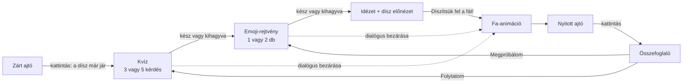

# Adventi kalendárium – React + Vite fejlesztési dokumentáció

Nov 11, 2026 · @Zsolt

## Áttekintés

Az alkalmazás egy böngészőben futó adventi kalendárium React + Vite alapon, az A változat (vidám, cukorkaszínű ajtók) dizájnjával. Minden nap kinyitása egy rövid, háromrészes játékot indít egy felugró ablakban, a végén pedig egy dísz kerül a közös díszítendő fenyőfára.

Egy nap tartalma:

1. **Kvíz:** 3 karácsonyi kérdés (érdekességek, filmek, zenék stb.), egyesével, 3–4 válaszlehetőséggel.
2. **Emoji-rejtvény:** egy emojisor, ami szót, filmcímet vagy dalcímet rejt. A választ be kell írni, 2 egyesével feloldható tipp segít.
3. **Zárás:** kedves karácsonyi idézet, majd egy új dísz megjelenése a fán.

**December 24. különleges nap:** a kvíz 5 kérdéses, az emoji-részben pedig 2 rejtvény vár egymás után.

Minden rész átugorható, és később egy gombbal vissza lehet térni hozzá. A díszt a nap megnyitása után mindenképp megkapja a játékos, a megfejtésektől függetlenül. Az előrehaladás localStorage-ban tárolódik, így ugyanazon az eszközön és böngészőben megmarad. Az alkalmazás GitHubról Netlifyra kerül ki, backend nélkül.

Az oldal kétnyelvű (magyar és angol), a fejlécben lévő nyelvváltóval. A jövőbeli napok zárolva vannak, december 1. előtt egyetlen ajtó sem nyitható. Web Audio API-val szóló csengőhang és halk karácsonyi háttérdallam köszönti a játékost, mindkettő külön kikapcsolható. Az eredmény megosztható képes kártyáként.

A meglévő HTML/CSS protótípus (kalendáriumrács, ajtónyitás, visszaszámláló, mentés) a kiindulópont: a dizájnja változatlanul átkerül, a kódja React komponensekre bomlik.

## A napi folyamat

Egy ajtó kinyitása egy dialógust indít három lépéssel: kvíz, emoji-rejtvény, idézet. A végén mindig jár egy dísz a fára. A dialógus tetején lépésjelző mutatja, hol tart a játékos (Kvíz, Rejtvény, Idézet).



Az átugrás sosem zárja le a napot: a dísz megjár, a kihagyott rész pedig később a nyitott ajtóról folytatható.

**Kvíz:**

- Egyszerre egy kérdés látszik, alatta 3–4 válaszgomb és egy hárompöttyös jelző (1/3, 2/3, 3/3).
- Egy kérdésre egy tipp van. Választás után a helyes válasz zölden kiemelődik, hibánál a választott piros lesz; ha van `explanation`, egy mondatos érdekesség jelenik meg. Utána a „Következő kérdés” gomb visz tovább.
- A „Kvíz kihagyása” gomb a hátralévő kérdéseket ugorja át; a már megválaszoltak megmaradnak.

**Emoji-rejtvény:**

- Nagy méretben az emojisor, alatta a típusa (szó, film vagy dal), egy szövegmező és az „Ellenőrzöm” gomb. Enter is beküldi.
- Hibás válasznál a mező megrázkódik, és ez jelenik meg: „Nem ez az, próbáld újra!” A próbálkozások száma nem korlátozott.
- Két zárt tippkártya: az első bármikor felfedhető, a második csak az első után.
- A „Rejtvény kihagyása” nem mutatja meg a megfejtést, így később tisztán újrapróbálható.

**December 24.:** a folyamat ugyanaz, csak hosszabb. A kvíz 5 kérdés, a jelző 5 pöttyös. Az emoji-részben 2 rejtvény jön egymás után („1 / 2”, „2 / 2”), mindkettőnek saját 2 tippje van. A „Rejtvény kihagyása” mindig csak az aktuális rejtvényt ugorja át, így az egyik megfejthető, a másik későbbre hagyható. A komponensek nem tudják, hányadik nap van: a kérdések és rejtvények számát a tartalomfájl tömbjeinek hossza adja.

**Idézet és dísz:** az idézet alatt kis előnézetben látszik az új dísz, a „Díszítsük fel a fát!” gomb bezárja a dialógust, és elindítja a fa animációját.

**Visszatérés:** nyitott ajtóra kattintva összefoglaló nyílik: kvízeredmény (pl. „2 / 3 helyes”), a rejtvény állapota és az idézet. Ha valami ki lett hagyva, mellette „Folytatom” gomb indítja újra pontosan ott, ahol abbamaradt.

## Dizájnrendszer

A vizuális nyelv az A változaté változatlanul: fenyőzöld kalendáriumtábla, csomagolópapír-mintás, kerekített ajtók, Baloo 2 betűtípus. A színek CSS változók a `:root`-on, sötét módban felülírva, így React alatt is egyetlen `tokens.css` fájlban maradnak.

| Token | Világos | Sötét | Szerep |
| --- | --- | --- | --- |
| `--bg` | #E4F3EC | #0B2A22 | Oldalháttér |
| `--ink` | #123C30 | #F3FBF7 | Szöveg |
| `--pine` | #146B4E | #1F8A63 | Kalendáriumtábla, gombok |
| `--red` | #E2384B | #E2384B | Cím, fő akcentus, hiba |
| `--gold` | #F5BE3A | #F5BE3A | Kilincs, fókusz, csillagok |
| `--pink` | #FF9FB2 | #FF9FB2 | Ajtószín |
| `--inside` | #FFF6DC | #2A1F12 | Ajtó mögötti felület, a fa mögötti szoba fala |
| `--soot` | #231D22 | #231D22 | A fa mögötti szoba: a cica fekete bundája, a kandalló tűztere |

**Betűtípus:** Baloo 2 (500, 700, 800) saját kiszolgálással, a `@fontsource/baloo-2` csomagból (`latin` és `latin-ext` részhalmaz az ő/ű miatt), így nem megy kérés harmadik félhez. Tartalék: Nunito, Trebuchet MS, system-ui. A cím 800-as súlyt és rétegzett, arany-zöld szövegárnyékot kap.

**Animációk, amelyek átkerülnek:**

- **Ajtónyitás:** 3D `rotateY(-112deg)`, 0,8 s, rugalmas görbe; a kitárult fedél ezután elhalványul és eltűnik, hogy ne takarja a szomszédos ajtókat. Az ajtó mögött a nap dísze jelenik meg pop animációval.
- **Belépés:** az ajtók betöltéskor 45 ms-os késleltetéssel egymás után „lepottyannak”.
- **Hóesés és címbillegés:** folyamatos háttéranimáció.
- **Visszaszámláló:** a változó szám kicsit megugrik.

**Új elemek ugyanebben a stílusban:** a dialógus fehér, 28 px-es lekerekítésű lap, piros alsó „peremmel” (mint a visszaszámláló dobozai). A válaszgombok a pill alakú számtáblák formáját veszik át. Helyes válasz: zöld kiemelés és rövid konfetti; hibás: piros rázkódás.

**Akadálymentesség:** az ajtók billentyűzettel nyithatók, látható arany fókuszkerettel. A zárolt ajtó `aria-disabled="true"` jelölést kap (nem `disabled`), így fókuszálható marad, és Enterre ugyanúgy kiírja, mikor nyílik. A dialógus natív `<dialog>` elem: fókuszcsapda, Esc-re és a háttérre kattintva bezár, bezárás után a fókusz a megnyitó ajtóra kerül vissza. A `prefers-reduced-motion` beállítás kikapcsolja a hóesést, a belépő animációt, a konfettit és a dísz leesését. A helyes/hibás visszajelzés szövegben is megjelenik, nem csak színnel, és `aria-live="polite"` régióban van, hogy a képernyőolvasó is bemondja; ugyanez igaz a zárolt ajtó üzenetére.

**Reszponzivitás:** 520 px alatt fix 3 oszlopos rács, a dialógus mobilon alsó lapként (bottom sheet) nyílik, teljes szélességben.

## Komponensek

Az alkalmazás egyetlen oldal, routing nélkül: felül a fejléc és visszaszámláló, középen a kalendárium, alatta a díszítendő fa, a napi játék pedig egy dialógusban nyílik a tetején. A komponensek nem tárolnak saját előrehaladást: minden állapot a `ProgressContext`-ből jön.

| Komponens | Felelősség | Fő props / adat |
| --- | --- | --- |
| `App` | Elrendezés, providerek (nyelv, előrehaladás, hang), aktív nap állapota | – |
| `Header` | Cím, bevezető, jobb felső sarokban a nyelvváltó és a hangkapcsolók | – |
| `LanguageSwitch` | HU / EN váltógomb-pár, az aktív nyelv kiemelve | – |
| `SoundControls` | Két külön kapcsoló: hangeffektek és háttérzene | – |
| `Countdown` | Visszaszámlálás Szentestéig, utána üdvözlet | `target: Date` |
| `StartBanner` | December 1. előtt feltűnő felirat: mikor nyílik az első ablak | `opensAt: Date` |
| `Snowfall` | Dekoratív hóesés, `aria-hidden` | `count` |
| `Calendar` | A 24 ajtó rácsa a megadott sorrendben és méretekkel | `layout: DoorLayout[]` |
| `Door` | Egy ajtó: zárolt, zárt, nyitott állapot, nyitási animáció | `day`, `variant`, `status`, `onOpen` |
| `DayDialog` | A napi játék kerete, lépésjelző, bezárás, a megfelelő lépés megjelenítése | `day`, `onClose` |
| `QuizStep` | Egy kérdés egyszerre (3 vagy 5), válaszgombok, visszajelzés, tovább / átugrás | `questions`, `progress` |
| `EmojiStep` | Rejtvények egymás után (1 vagy 2), szövegmező, 2 tipp rejtvényenként, átugrás | `puzzles`, `progress` |
| `QuoteStep` | Idézet és a megkapott dísz bemutatása | `quote`, `ornament` |
| `TreeScene` | A fa, a 24 dísz helyével; a megszerzettek teli, a többi halvány körvonal | `ornaments`, `earned` |
| `ProgressSummary` | „X / 24 ablak nyitva”, pontszám, megosztás gomb, visszaállítás megerősítéssel | – |
| `ShareCard` | A megosztható eredménykártya előnézete és megosztása | `stats`, `lang` |

A `Door` három állapota: **zárolt** (jövőbeli nap, enyhén halvány, kattintásra rázkódik és kiírja, hány nap múlva nyílik), **zárt** (nyitható), **nyitott** (a fedél eltűnt, a szám helyén a nap megkapott dísze látszik egyszínű sziluettként, a belső felület szövegszínével; ha maradt átugrott rész, egy kis arany pötty jelzi). Nyitott ajtóra kattintva újra megnyílik a dialógus, ahol az átugrott részek folytathatók.

**Dátumzár:** egy nap a helyi idő szerinti napjának 00:00-jától nyitható, a korábbi napok bármikor utólag is. December 1. előtt minden ajtó zárolt, és a kalendárium felett a `StartBanner` jelenik meg arany keretes, enyhén pulzáló csíkként: „Az első ablak december 1-jén nyílik – még 20 nap!” (a szám naponta frissül). A zárolt ajtó kattintásra rázkódik, és egy rövid buborék kiírja, hány nap múlva nyílik („Holnap nyílik” / „5 nap múlva nyílik”); pontos dátumot nem ír, így nincs szükség magyar toldaléktáblára. December 24. után minden ajtó nyitható marad, így az elmaradt napok később is bepótolhatók.

**Éjféli váltás:** a „mai nap” egy `useNow()` hookból jön, ami éjfélkor és a fülre visszatéréskor (`visibilitychange`) frissül. Aki nyitva hagyja az oldalt, annak az új ajtó frissítés nélkül válik nyithatóvá.

## Adatmodell

A 24 nap tartalma egyetlen típusos fájlban él (`src/content/days.ts`), így a TypeScript fordításkor jelzi, ha egy napból hiányzik valami. A tartalom statikus, a buildbe kerül, backend nem kell.

```ts
export type Lang = 'hu' | 'en';
export type L = Record<Lang, string>;   // minden megjelenő szöveg mindkét nyelven

export type Category = 'erdekesseg' | 'film' | 'zene' | 'hagyomany' | 'etel';

export interface QuizQuestion {
  id: string;              // pl. 'd01-q1'
  category: Category;
  question: L;
  options: L[];            // 3 vagy 4 elem
  correctIndex: number;    // a helyes válasz indexe az options tömbben
  explanation?: L;         // rövid érdekesség a válasz után
}

export interface EmojiPuzzle {
  id: string;              // pl. 'd24-e2'
  emojis: string;          // pl. '❄️👸⛄'
  kind: 'szo' | 'film' | 'dal';
  answers: Record<Lang, string[]>; // elfogadott alakok nyelvenként, az első a kanonikus
  hints: [L, L];           // pontosan 2 tipp, sorrendben oldhatók fel
}

export interface Quote {
  text: L;                 // közkincs vagy saját szöveg, saját fordítással
  author?: L;              // kétnyelvű: személynévnél a két érték azonos, de pl. 'népi mondás' / 'folk saying'
  source?: L;
}

export type OrnamentShape =
  | 'bauble' | 'candyCane' | 'bell' | 'bow' | 'star' | 'snowflake'
  | 'gingerbread' | 'boot' | 'gift' | 'candle' | 'szaloncukor' | 'pinecone';
export type OrnamentColor = 'red' | 'gold' | 'purple' | 'blue' | 'pink' | 'silver' | 'white';

export interface Ornament {
  id: string;              // egyedi azonosító, pl. 'd01-bauble-red'
  shape: OrnamentShape;    // melyik rajz
  color?: OrnamentColor;   // a díszpaletta kulcsa; ha nincs, az alakzat alapszíne
  name: L;
  slot: { x: number; y: number }; // a fa SVG egységeiben: x 0–100, y 0–120
}

export interface DayContent {
  day: number;             // 1–24
  quiz: QuizQuestion[];    // 1–23. nap: 3 elem, 24. nap: 5 elem
  emoji: EmojiPuzzle[];    // 1–23. nap: 1 elem, 24. nap: 2 elem
  quote: Quote;
  ornament: Ornament;
}
```

Egy kitöltött nap mintának:

```ts
{
  day: 1,
  quiz: [
    { id: 'd01-q1', category: 'hagyomany',
      question: { hu: 'Melyik országból terjedt el a feldíszített karácsonyfa szokása?',
                  en: 'Which country did the decorated Christmas tree tradition spread from?' },
      options: [
        { hu: 'Németország', en: 'Germany' }, { hu: 'Olaszország', en: 'Italy' },
        { hu: 'Finnország', en: 'Finland' },  { hu: 'Spanyolország', en: 'Spain' } ],
      correctIndex: 0 },
    { id: 'd01-q2', category: 'film',
      question: { hu: 'Melyik filmben hagyják otthon véletlenül Kevin McCallistert?',
                  en: 'In which film is Kevin McCallister accidentally left at home?' },
      options: [
        { hu: 'Reszkessetek, betörők!', en: 'Home Alone' },
        { hu: 'Igazából szerelem', en: 'Love Actually' },
        { hu: 'A Grincs', en: 'The Grinch' } ],
      correctIndex: 0 },
    { id: 'd01-q3', category: 'zene',
      question: { hu: 'Ki énekli az „All I Want for Christmas Is You” című dalt?',
                  en: 'Who sings “All I Want for Christmas Is You”?' },
      options: [
        { hu: 'Mariah Carey', en: 'Mariah Carey' }, { hu: 'Whitney Houston', en: 'Whitney Houston' },
        { hu: 'Céline Dion', en: 'Céline Dion' },   { hu: 'Kylie Minogue', en: 'Kylie Minogue' } ],
      correctIndex: 0 },
  ],
  emoji: [{
    id: 'd01-e1',
    emojis: '❄️👸⛄',
    kind: 'film',
    answers: { hu: ['Jégvarázs'], en: ['Frozen'] },
    hints: [
      { hu: '2013-as Disney-animációs film', en: 'A 2013 Disney animated film' },
      { hu: 'Az egyik nővér jéggel varázsol', en: 'One of the sisters has ice powers' } ],
  }],
  quote: {
    text: { hu: 'Szívemben tisztelni fogom a karácsonyt, és igyekszem egész évben megtartani.',
            en: 'I will honour Christmas in my heart, and try to keep it all the year.' },
    author: { hu: 'Charles Dickens', en: 'Charles Dickens' },
    source: { hu: 'Karácsonyi ének', en: 'A Christmas Carol' } },
  ornament: { id: 'd01-bauble-red', shape: 'bauble', color: 'red',
              name: { hu: 'Piros gömb', en: 'Red bauble' }, slot: { x: 38, y: 72 } },
}
```

**Válaszellenőrzés az emoji-rejtvénynél:** a beírt szöveget mindkét nyelv összes elfogadott válaszával összevetjük, így egy magyar játékos az angol filmcímmel („Frozen”) is nyer. Az összehasonlítás előtt mindkét oldal ugyanazon a `normalize()` függvényen megy át: kisbetűsítés, szóközök levágása, ékezetek törlése (`NFD` + diakritikus jelek), írásjelek törlése, és a kezdő névelő elhagyása (a, az, the). Így a „jegvarazs” és a „JÉGVARÁZS!” is elfogadott. Elgépelés-tűrés (Levenshtein) az első kiadásban nincs; ha a tesztelők kérik, a `normalize.ts`-be utólag betehető (1 karakter eltérés, 5 karakternél hosszabb válaszoknál).

**Tartalomellenőrzés:** egy Vitest teszt végigmegy a `days.ts`-en, és jelez, ha egy napnak nem 3 (a 24.-nek nem 5) kérdése vagy nem 1 (a 24.-nek nem 2) rejtvénye van, ha hiányzik egy fordítás, ha a `correctIndex` kilóg az opciók közül, vagy ha egy dísz `slot`-ja kívül esik a fa rajzán. A teljes lista a [tartalom-útmutatóban](03-tartalom-utmutato.md) van.

**Kvíz:** a válaszlehetőségek sorrendjét megjelenítéskor a kérdés `id`-jából képzett, rögzített seeddel keverjük, így minden kérdés saját sorrendet kap, és az minden betöltéskor ugyanaz. A tartalomfájlban a helyes válasz nyugodtan lehet mindig az első, a képernyőn nem mindig ott látszik. A keverés csak megjelenítés: a `correctIndex` és a mentett válasz mindig a tartalomfájl szerinti eredeti indexet jelenti. Egy kérdésre egy tipp van; a helyes válasz hiba esetén is megmutatódik.

**Megjegyzés:** a válaszok a JavaScript csomagban olvashatók. Egy hobbi kalendáriumnál ez elfogadható; ha nem, a válaszok hash-elve tárolhatók (a `normalize()` utáni SHA-256).

## Állapot és mentés

Az egész előrehaladás egyetlen localStorage kulcs alatt, egyetlen JSON objektumban él (`advent-2026:v1`). Minden változás azonnal mentődik, így egy oldalfrissítés vagy bezárt fül sem veszt el semmit.

```ts
export type StepStatus = 'pending' | 'done' | 'skipped';

export interface QuizProgress {
  answers: (number | null)[]; // kérdésenként a választott (eredeti, nem kevert) index (3 vagy 5 elem)
  status: StepStatus;         // 'done' = minden kérdés megválaszolva
}

export interface PuzzleProgress {
  hintsRevealed: 0 | 1 | 2;
  attempts: number;
  status: StepStatus;         // 'done' = megfejtve
}

export interface DayProgress {
  openedAt: string;          // ISO időpont az első nyitáskor
  quiz: QuizProgress;
  emoji: PuzzleProgress[];   // rejtvényenként (1 vagy 2 elem)
  quoteSeen: boolean;
  ornamentShown: boolean;    // lefutott-e már a dísz fa-animációja
}

export interface SaveData {
  version: 1;
  days: Record<number, DayProgress>; // csak a megnyitott napok szerepelnek
}

export interface Settings {    // külön kulcson: advent-2026:settings
  lang: Lang;                  // alapértelmezés: navigator.language alapján
  sfx: boolean;                // hangeffektek, alapértelmezés: be
  music: boolean;              // háttérzene, alapértelmezés: ki
  musicVolume: number;         // 0–1, alapértelmezés: 0.3
  theme: 'auto' | 'light' | 'dark'; // alapértelmezés: 'auto' (a rendszer beállítása)
  catName: string;             // a cica neve, legfeljebb 10 karakter, alapértelmezés: 'Lajos'
}
```

**Szabályok:**

- A **dísz** az ajtó nyitásának pillanatában jár (`OPEN_DAY`), a megfejtésektől függetlenül: megszerzett az a dísz, amelynek a napja szerepel a `days`-ben, külön mező nem tárolja. A fa-animáció a dialógus bezárásakor fut le, és ekkor lesz `ornamentShown: true`. Ha a játékos a dialógus közben a fület zárja be, a dísz így is megvan, az animáció pedig a következő betöltéskor játszódik le.
- Egy **átugrott** rész később `pending`-be állítható vissza a „Folytatom a kvízt” / „Megpróbálom a rejtvényt” gombbal. A kvíz az első megválaszolatlan kérdésnél folytatódik.
- A **megválaszolt** kvízkérdés nem válaszolható újra, a megfejtett rejtvény nem kérdezhető újra; visszatéréskor csak az eredmény látszik.
- A **pontszám** számolt érték, nem tárolt: helyes kvízválaszok (max. 23 × 3 + 5 = 74) + megfejtett rejtvények (max. 23 + 2 = 25).

**Megvalósítás:** egy `useProgress()` hook és a `ProgressContext` adja az állapotot. Belül `useReducer` fut olyan akciókkal, mint `OPEN_DAY`, `ANSWER_QUESTION`, `SKIP_QUIZ`, `REVEAL_HINT`, `SUBMIT_GUESS`, `SKIP_EMOJI`, `RESUME_STEP`, `FINISH_DAY`, `ORNAMENT_SHOWN`, `HYDRATE` és `RESET`. Egy `useEffect` minden változás után ment.

**Robusztusság:** minden localStorage hívás `try/catch`-ben van (privát mód, betelt tárhely). Betöltéskor a hibás vagy ismeretlen verziójú adat üres mentésre cserélődik; egy későbbi `version: 2` egy `migrate()` függvénnyel alakítja át a régit. Egy `storage` eseményfigyelő szinkronban tartja a több nyitott fület: a másik fül állapotát a `HYDRATE` akció veszi át. Hogy a két fül ne írogassa egymást oda-vissza, mentés csak akkor történik, ha a sorosított állapot eltér a tárolttól.

**Beállítások külön:** a nyelv és a hangok a `Settings` objektumban, saját kulcson élnek. Így az „Előrehaladás törlése” nem állítja vissza a nyelvet és a hangkapcsolókat.

## Kétnyelvűség (magyar és angol)

A nyelvváltás könyvtár nélkül, egy kis saját megoldással történik: a felület kb. 60 szövege két szótárfájlban él, a napi tartalom pedig eleve mindkét nyelvet tartalmazza (`L` típus). Ha a szövegek száma később nagyon megnő, a `react-i18next` könnyen beköthető.

```ts
// src/i18n/hu.ts – az en.ts ugyanezekkel a kulcsokkal
export const hu = {
  'header.title': 'Advent 2026',
  'countdown.until': 'Szentestéig még',
  'quiz.next': 'Következő kérdés',
  'quiz.skip': 'Kvíz kihagyása',
  'emoji.check': 'Ellenőrzöm',
  'emoji.wrong': 'Nem ez az, próbáld újra!',
  'banner.opens': 'Az első ablak december 1-jén nyílik – még {n} nap!',
  'door.opensIn': '{n} nap múlva nyílik',
  'door.opensTomorrow': 'Holnap nyílik',
  // ...
} as const;
export type MessageKey = keyof typeof hu; // az en.ts-nek ugyanezt kell teljesítenie
```

- **Használat:** a `useI18n()` hook adja a `lang`, `setLang`, `t(key, params)` és `pick(l: L)` függvényeket. A `pick` a napi tartalom kétnyelvű mezőiből választja ki az aktuálisat.
- **Kezdő nyelv:** a mentett beállítás; ha nincs, a `navigator.language` alapján magyar, egyébként angol. A `?lang=en` URL-paraméter felülírja (a megosztott linkekhez hasznos), de csak arra a betöltésre: a mentett beállítást nem írja át, amíg a játékos maga nem vált nyelvet.
- **Váltáskor** frissül a `<html lang>` és a `document.title`. Az előrehaladás azonosítókhoz kötött, nem szöveghez, ezért egy nyitott dialógus közben is nyugodtan váltható a nyelv.
- **Dátumok és többes szám:** a felület nem formáz dátumot. Az egyetlen dátumos mondat (a december 1-jei felirat) fix szövegként áll a szótárban, a zárolt ajtó pedig relatív időt ír. Paraméter csak a napok száma; az angol többes számot az `Intl.PluralRules` adja („1 day”, „5 days”).
- **Idézőjelek:** magyarul „ ”, angolul “ ”; ezek a szótárban és a tartalomban vannak, nem a kódban.
- **Nyelvváltó:** két kis pill gomb (HU / EN) a fejléc jobb felső sarkában, `aria-pressed` jelöléssel.
- **Ellenőrzés:** egy teszt jelez, ha egy kulcs az egyik szótárból hiányzik; a `MessageKey` típus ezt fordításkor is kikényszeríti.

## Hang és zene

Mindkettő jól megoldható a böngésző beépített Web Audio API-jával, hangfájlok nélkül: a csengőszót és a dallamot is a kód szintetizálja. Ez kicsi csomagméretet ad, és nincs jogdíjkérdés, mert felvétel nem kerül az oldalba.

**Felépítés:**

```text
src/audio/
  engine.ts     # egyetlen AudioContext, master / sfx / music GainNode-ok
  sfx.ts        # hangeffektek: chime(), success(), wrong(), hint(), sparkle()
  music.ts      # ütemező + egyszerű szinti, dallamok ismétlése
  melodies.ts   # közkincs dallamok hangjegytömbként
  useSound.ts   # React hook a beállításokkal összekötve
```

**Hangeffektek (alapértelmezésben bekapcsolva):**

| Esemény | Hang |
| --- | --- |
| Ajtónyitás | Felfelé suhanó zaj, a végén puha, fás pukkanás (szándékosan nem csengő, hogy elüssön a zenétől) |
| Zárolt ajtó | Két gyors, tompa kopogás: „még nem nyitható” |
| Helyes válasz | Két felfelé lépő csengőhang |
| Hibás válasz | Két lefelé lépő, puha hang; kis hangszórón is hallható, de nem büntető hangzású |
| Tipp felfedése | Rövid, halk koppanás |
| Rejtvény megfejtve | Háromhangos, felfelé futó arpeggio |
| Dísz a fán | Csillogó, magas csengőfüzér |

A csengőhang additív szintézis: néhány szinuszoszcillátor a harangokra jellemző, nem harmonikus felhangarányokkal (kb. 1 : 2 : 2,76 : 5,4), gyors felfutással és 1–2 másodperces exponenciális lecsengéssel. Egy enyhe zengés (generált impulzusválaszú `ConvolverNode`) teszi kellemesebbé.

**Háttérzene (alapértelmezésben kikapcsolva):** közkincsbe tartozó dallamok saját lejegyzésben, puha háromszög-hullámos szintivel, aluláteresztő szűrővel és zengéssel, „zenedoboz” hangzással. Javasolt dallamok: Csendes éj (Franz Gruber, 1818), Jingle Bells (James Lord Pierpont, 1857), Deck the Halls (walesi népdal), O Tannenbaum (német népdal). Ezek egymás után, rövid szünettel ismétlődnek. Az ütemező a bevált „lookahead” mintát követi: 25 ms-onként előre beütemezi a következő 100 ms hangjait, így a ritmus akkor is pontos, ha a főszál épp animációval van elfoglalva.

**Szabályok:**

- A böngészők csak felhasználói művelet után engednek hangot. Az `AudioContext` ezért az első kattintáskor jön létre (vagy `resume()`-ol), a zene pedig csak a kapcsoló megnyomására indul.
- Két külön kapcsoló van a fejlécben (hangeffektek, zene), az állapotuk a `Settings`-be mentődik. A zene mellett egy hangerőcsúszka és egy dallamváltó gomb is van: a gomb a következő dallam elejére ugrik, és a neve megmondja, melyik dallam szól éppen. A kiválasztott dallam nem mentődik, minden betöltés az elsővel indul.
- Háttérbe került fülön (`visibilitychange`) a zene elhalkul és szünetel, visszatéréskor folytatódik.
- Ha az oldal újratöltéskor „zene: be” állapotban van, a zene az első kattintásra indul el, nem magától.

**Jogdíj:** a dallamok közkincsek, és mivel a kód saját lejegyzésből szintetizálja őket, nincs felvételi jog sem. Ha később valódi felvétel kellene, csak CC0 vagy saját felvétel jöhet szóba, mert egy közkincs dal felvétele is lehet jogvédett.

## Megosztható eredménykártya

A kártya egy 1080 × 1350 px-es PNG kép (álló, közösségi médiához illő arány), amit a böngésző Canvas API-ja rajzol meg, szerver nélkül. Bármikor elérhető a `ProgressSummary` „Megosztom” gombjával, a 24. nap után pedig külön is felajánljuk.

**Tartalma, az aktív nyelven:**

- Cím: „Advent 2026”, az A változat címstílusával.
- A fenyőfa kicsinyített képe a megszerzett díszekkel.
- Nagy számokkal: díszek száma (pl. „18 / 24 dísz”) és pontszám („61 pont”).
- Kisebben: helyes kvízválaszok (pl. 52 / 74) és megfejtett rejtvények (9 / 25).
- Alul az oldal címe, hogy mások is kipróbálhassák.

**Készítés:** a fa ugyanabból a `TreeScene` SVG-ből készül: szerializálás, `Image`-be töltés, majd `drawImage` a vászonra. A képként betöltött SVG elszigetelt dokumentum, amelyben nem érvényesülnek a CSS-osztályok, a CSS-változók és a webfontok. Ezért a `TreeScene` a színeit egy `palette` propból kapja, és SVG-attribútumként írja ki (`fill="#146B4E"`); a kártya mindig a világos palettát adja át, a sötét módtól függetlenül. A kártya minden szövegét a Canvas rajzolja (`fillText`), az SVG-ben nincs szöveg és nincs `foreignObject`. Rajzolás előtt meg kell várni a `document.fonts.ready`-t, különben a Baloo 2 helyett tartalékbetű kerülhet a képre.

A kép a megosztó dialógus megnyitásakor készül el, nem a gomb megnyomásakor: a `navigator.share()` csak közvetlenül kattintásból hívható, ezért a „Megosztom” gombnak már kész fájlt kell átadnia.

**Megosztás:**

1. Ha a böngésző támogatja (`navigator.canShare({ files })`, jellemzően mobilon), a Web Share API a rendszer megosztási menüjét nyitja a képpel és egy rövid szöveggel.
2. Egyébként a dialógusban a kép előnézete látszik két gombbal: „Kép letöltése” (PNG) és „Szöveg másolása” (eredmény + link a vágólapra).

A kártya személyes adatot nem tartalmaz. A linkelőnézethez (amikor valaki csak a címet osztja meg) egy statikus `og-image.png` kerül a `public` mappába, mert egy statikus oldal nem tud játékosonként eltérő előnézeti képet adni.

## A díszíthető fenyőfa

Az ötlet jól megvalósítható, külön könyvtár nélkül: a javaslat egyetlen nagy fenyőfa SVG-ben, 24 előre kijelölt díszhellyel. A megszerzett díszek teli színnel látszanak, a többi helyén halvány, szaggatott körvonal jelzi, mi vár még a játékosra. A 24. nap a csúcsdísz, így a fa karácsonyra lesz kész.

| Változat | Munka | Hatás | Megjegyzés |
| --- | --- | --- | --- |
| **Egy fenyőfa (javasolt)** | Kicsi–közepes | Erős, azonnal érthető | Egy SVG, a díszek egyszerű alakzatok; mobilon is jól látszik |
| Karácsonyi házikó | Közepes | Hangulatos | A díszek (koszorú, fényfüzér, hóember) szétszórtabbak, nehezebb a 24 helyet érthetően elhelyezni |
| Karácsonyi tér vagy park | Nagy | Látványos | Sok külön rajzolt elem, mobilon kicsik lesznek; inkább későbbi bővítésnek |

**Működés:**

- A `TreeScene` egy `viewBox="0 0 100 120"` SVG. A díszek pozíciója a tartalomfájl `ornament.slot` mezőjéből jön, közvetlenül a rajz egységeiben (`x` 0–100, `y` 0–120), így átrendezéshez nem kell kódhoz nyúlni, és a fa alatti ajándékok (`y` > 100) is elférnek.
- Minden dísz egy kis React SVG-komponens (`<Bauble color="red" />`, `<CandyCane />`, `<Star />` stb.), amelyet a tartalomfájl `shape` mezője választ ki. Egy alakzat több színnel is felhasználható: 12 rajz adja ki a 24 díszt. Emojit nem javaslok, mert operációs rendszerenként máshogy néz ki.
- A díszek színe a `color` mezőből jön, egy hétszínű díszpalettáról (piros, arany, lila, kék, rózsaszín, ezüst, fehér; zöld nincs, mert a zöld fán nem látszana jól). A paletta a `tokens.css`-ben és a `TreeScene` `palette` propjában él; a színek SVG-attribútumként kerülnek ki, hogy a megosztókártya is ki tudja rajzolni a fát.
- **Nem megszerzett** dísz: azonos alak, `fill: none`, szaggatott körvonal, 30% átlátszóság. **Megszerzett:** teli szín és enyhe, folyamatos lengetés.
- **A megszerzés pillanata:** a dialógus utolsó lépése megmutatja az új díszt. Bezáráskor az oldal simán a fához görget, a dísz felülről a helyére esik egy kis ráugrással, és néhány csillogás jelzi.
- A fa alatt a számláló: „7 / 24 dísz a fán”. A 24. dísz után a fa fényei felgyulladnak, és megjelenik egy ünnepi záróüzenet.

**A 24 dísz sorrendje** (szabadon cserélhető; a 6. a Mikulás, a 24. a Szenteste miatt van ott). A lista 12 alakzatból áll: gömb, cukorpálca, csengő, masni, csillag, hópehely, mézeskalács, csizma, ajándék, gyertya, szaloncukor, toboz. Fényfüzér nincs a díszek között, a fények a 24. nap jutalmai.

| Nap | Dísz | Alakzat | Nap | Dísz | Alakzat |
| --- | --- | --- | --- | --- | --- |
| 1 | Piros gömb | `bauble` | 13 | Rózsaszín szaloncukor | `szaloncukor` |
| 2 | Arany gömb | `bauble` | 14 | Ezüst hópehely | `snowflake` |
| 3 | Piros cukorpálca | `candyCane` | 15 | Ezüst csengő | `bell` |
| 4 | Mézeskalács-figura | `gingerbread` | 16 | Arany szaloncukor | `szaloncukor` |
| 5 | Arany csengő | `bell` | 17 | Rózsaszín gömb | `bauble` |
| 6 | Mikuláscsizma | `boot` | 18 | Kék cukorpálca | `candyCane` |
| 7 | Lila gömb | `bauble` | 19 | Arany masni | `bow` |
| 8 | Fehér hópehely | `snowflake` | 20 | Arany kiscsillag | `star` |
| 9 | Fenyőtoboz | `pinecone` | 21 | Ezüst gömb | `bauble` |
| 10 | Kék gömb | `bauble` | 22 | Gyertya | `candle` |
| 11 | Piros masni | `bow` | 23 | Ajándékok a fa alatt | `gift` |
| 12 | Piros ajándékdoboz | `gift` | 24 | Csillag a csúcson | `star` |

## Technológia és projektstruktúra

A projekt a `react-ts` Vite sablonra épül, minimális függőséggel: állapotkezeléshez elég a React beépített `useReducer` + Context párosa, a stílusokhoz pedig a protótípus sima CSS-e (CSS Modules-ként).

```bash
corepack enable                      # a Node-dal jövő Corepack kezeli a Yarn verzióját
yarn create vite . --template react-ts   # a meglévő projektmappába; a docs/ maradhat
yarn set version stable              # rögzíti a Yarn verziót a package.json-ben
yarn config set nodeLinker node-modules
yarn install
yarn add canvas-confetti @fontsource/baloo-2
yarn add -D vitest @testing-library/react @testing-library/jest-dom jsdom
```

A csomagkezelő a Yarn. A `nodeLinker: node-modules` beállítás (a `.yarnrc.yml`-ben) a hagyományos `node_modules` mappát használja Plug'n'Play helyett, így a Vite és a szerkesztők külön beállítás nélkül működnek. A `yarn.lock` és a `.yarnrc.yml` kerüljön a repo-ba, `package-lock.json` ne legyen mellette. A `package.json`-be kerüljön egy `"test": "vitest"` szkript is.

| Csomag | Mire | Kötelező? |
| --- | --- | --- |
| `react`, `react-dom` | Felület | Igen |
| `vite`, `typescript` | Build és típusok | Igen |
| `@fontsource/baloo-2` | A Baloo 2 betűtípus saját kiszolgálása | Igen |
| `canvas-confetti` | Konfetti a helyes válasznál és a megfejtésnél | Nem, CSS-sel is megoldható |
| `vitest`, `@testing-library/react` | Tesztek a `normalize()`-ra, a reducerre és a mentésre | Ajánlott |

```text
src/
  main.tsx
  App.tsx
  styles/
    tokens.css          # színek, sötét mód, betűtípus
    global.css          # alapstílusok, reduced-motion
  components/
    Header/  LanguageSwitch/  SoundControls/
    Countdown/  StartBanner/  Snowfall/
    Calendar/  Door/
    DayDialog/  QuizStep/  EmojiStep/  QuoteStep/
    TreeScene/          # Tree.tsx + ornaments/*.tsx
    ProgressSummary/  ShareCard/
  content/
    days.ts             # a 24 nap kétnyelvű tartalma
    layout.ts           # ajtók sorrendje, mérete, színe, mintája
  i18n/
    hu.ts  en.ts        # felületi szövegek
    I18nContext.tsx     # useI18n(): lang, setLang, t(), pick()
  audio/
    engine.ts  sfx.ts  music.ts  melodies.ts  useSound.ts
  state/
    progress.ts         # típusok, reducer, akciók
    settings.ts         # nyelv, hangok
    ProgressContext.tsx
    storage.ts          # load / save / migrate, try/catch
  lib/
    normalize.ts        # válaszellenőrzés
    dates.ts            # dátumzár, visszaszámlálás célpontja, useNow()
    shuffle.ts          # seedelt keverés a kvízválaszokhoz
    shareCard.ts        # Canvas rajzolás, Web Share, letöltés
public/
  favicon.svg  og-image.png
netlify.toml
CLAUDE.md
docs/
  SPEC.md               # ez a dokumentum
  prototype.html        # a dizájn forrása
  01-spec-atnezes.md  02-fejlesztesi-terv.md
  03-tartalom-utmutato.md  04-teszteles-es-elesites.md
```

**Dátumkezelés:** a `dates.ts` a felhasználó helyi idejét használja. A dátumok mindig `new Date(YEAR, 11, n)` formában jönnek létre (a szöveges `'2026-12-01'` alak UTC éjfélt jelentene, Magyarországon 01:00-t), az évszám egyetlen `YEAR` konstansban él. Az `n`. nap 2026. december `n`. 00:00-tól nyitható, utána bármikor; december 1. előtt semmi sem nyitható. A visszaszámlálás célpontja december 24. 00:00. A `VITE_UNLOCK_ALL=true` környezeti változó minden ajtót nyithatóvá tesz, bármilyen buildben, ahol be van állítva: helyben fejlesztéshez, a Netlifyon pedig csak az előnézeti (Deploy Preview) környezetben. A `?date=2026-12-10` URL-paraméter tetszőleges napot szimulál, de csak fejlesztői módban (`import.meta.env.DEV`); az éles buildből kiesik.

**Claude Code-dal:** a specifikáció a `docs/SPEC.md`, a HTML protótípus a `docs/prototype.html`. A gyökérben egy rövid `CLAUDE.md` mondja meg a lényeget: a specifikáció helye, a dizájn forrása a protótípus, a parancsok (`yarn dev`, `yarn test`, `yarn build`), és hogy minden új felületi szöveg mindkét szótárba kerüljön. A munka a [fejlesztési terv](02-fejlesztesi-terv.md) fázisai szerint halad, fázisonként egy kérésben, és mindegyik után böngészőben meg kell nézni az eredményt.

## Telepítés: GitHub és Netlify

Az alkalmazás statikus oldalként megy ki: a Netlify minden `master` ágra történő push után lefuttatja a `yarn build` parancsot, és a `dist` mappát teszi közzé. Szerver vagy adatbázis nem kell, mert minden adat a böngészőben marad.

```toml
# netlify.toml
[build]
  command = "yarn build"
  publish = "dist"

[build.environment]
  NODE_VERSION = "22"

[context.deploy-preview.environment]
  VITE_UNLOCK_ALL = "true"   # az előnézeten minden ajtó nyitható, az éles oldalon nem

[[redirects]]
  from = "/*"
  to = "/index.html"
  status = 200
```

A Netlify a `yarn.lock` alapján magától Yarnnal telepíti a függőségeket, és a `package.json` `packageManager` mezőjéből tudja, melyik Yarn verziót használja.

1. Hozz létre egy GitHub repository-t, és töltsd fel a projektet (`git init`, `git add .`, `git commit`, `git push`).
2. A Netlifyon: **Add new site → Import an existing project → GitHub**, majd válaszd ki a repository-t. A „Production branch” legyen `master`.
3. A build-beállításokat a `netlify.toml` adja, kézzel nem kell megadni.
4. Az éles (production) környezetben a `VITE_UNLOCK_ALL` ne legyen beállítva, hogy a dátumzár működjön. Az előnézeti környezetben a fenti `netlify.toml` állítja be, a Netlify felületén nem kell megadni.
5. Egyedi domain a **Domain management** alatt köthető be; a HTTPS-t a Netlify automatikusan intézi.

**Fontos tudni a localStorage-ról:** a mentés domainhez kötött. Ha később domaint váltasz (például a `*.netlify.app` címről saját domainre), a játékosok előrehaladása nem költözik át, ezért érdemes a végleges címet december 1. előtt beállítani.

## Ütemterv és döntések

A december 1-jei induláshoz az alkalmazásnak november 28-ig élesben kell lennie. A legnagyobb munka most is a tartalom, ráadásul két nyelven: 74 kvízkérdés, 25 emoji-rejtvény 50 tippel és 24 idézet.

0. **Előkészítés (az első napon):** repo, Vite váz, és az üres oldal első kiadása Netlifyra a végleges címmel. Így a Yarn- és Node-beállítás hibái azonnal kiderülnek, és a mentés domainje korán rögzül.
1. **Alap (2 nap):** Vite projekt, `tokens.css`, a `Calendar`, `Door`, `Countdown`, `StartBanner` és `Snowfall` átültetése, dátumzár, `storage.ts` és reducer tesztekkel, valamint az i18n váz és a nyelvváltó rögtön az elején, hogy minden szöveg eleve szótárból jöjjön.
2. **Napi dialógus és kvíz (2 nap):** `DayDialog` lépésjelzővel, `QuizStep` egyesével megjelenő kérdésekkel (3 vagy 5), átugrás és folytatás.
3. **Emoji-rejtvény és zárás (1–2 nap):** `EmojiStep` egy vagy két rejtvénnyel, `normalize()`, tippek, `QuoteStep`.
4. **Fenyőfa (2–3 nap):** előbb az egyszerű, működő fa (gömb és csillag), utána a többi díszalakzat (összesen 12) és a megszerzés animációja.
5. **Hang és zene (1–2 nap):** hangmotor, hangeffektek, dallamütemező, a két kapcsoló.
6. **Megosztható kártya (1 nap):** Canvas rajzolás, Web Share, letöltés.
7. **Tartalom (párhuzamosan, 4–6 nap):** a 24 nap kitöltése mindkét nyelven és tényellenőrzése.
8. **Tesztelés és élesítés (1–2 nap):** mobil, sötét mód, billentyűzet, mindkét nyelv, Netlify, végleges domain.

**Ha csúszik a munka,** ebben a sorrendben marad ki valami: először a háttérzene, aztán a megosztható kártya (helyette szöveg és link másolása), a hangeffektek, végül a gömbön és csillagon túli díszalakzatok és a dísz animációja. Az angol tartalom december elején naponta pótolható, mert a napok úgyis zárolva vannak. A kalendárium, a napi dialógus, a 24 nap magyar tartalma, az egyszerű fa és az élesítés nem hagyható el. A részletek a [fejlesztési tervben](02-fejlesztesi-terv.md) vannak.

**Döntések:**

| Téma | Döntés |
| --- | --- |
| Dátumzár | A jövőbeli napok zároltak, a korábbiak bármikor nyithatók; december 1. előtt figyelemfelhívó felirat |
| Zárolt ajtó | Relatív üzenet („5 nap múlva nyílik”), fókuszálható, éjfélkor magától frissül |
| Dísz | Az ajtó nyitásakor jár; 12 alakzat több színben, fényfüzér nélkül |
| Kvízkeverés | Kérdésenkénti seed, a mentés eredeti indexet tárol |
| Dialógus | Esc-re és háttérkattintásra is bezár |
| Betűtípus | Baloo 2 saját kiszolgálással (`@fontsource`) |
| Elgépelés-tűrés | Az első kiadásban nincs |
| Előnézet | A Netlify Deploy Preview-n minden ajtó nyitható, az éles oldalon nem |
| Kiadás | Első Netlify-kiadás az első napon, a végleges címmel |
| Visszaszámlálás | Szenteste, december 24. 00:00 |
| Fejlesztés | Claude Code-ban, ez a dokumentum a specifikáció |
| Idézetek | Csak közkincs vagy saját szöveg, saját fordítással |
| Hang | Web Audio csengő és szintetizált közkincs dallamok, külön kikapcsolhatók |
| Megosztás | Canvasszal rajzolt eredménykártya, Web Share vagy letöltés |
| Nyelv | Magyar és angol, nyelvváltóval |
| December 24. | 5 kvízkérdés és 2 emoji-rejtvény |
